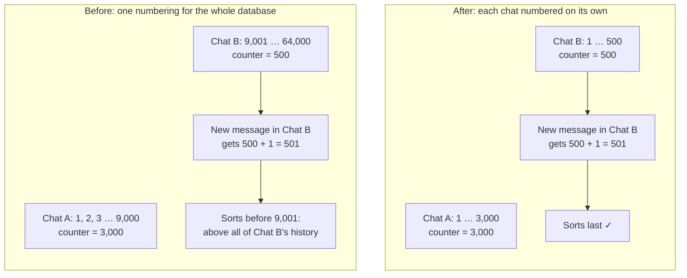
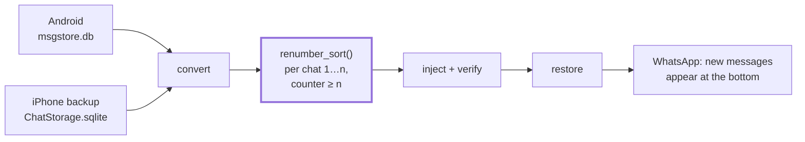

# New messages not showing after a migration

## Symptom

The migration works and the old chats are on the iPhone. But when you send or receive a message
afterwards, it doesn't show up in the conversation. The chat list may show it as the last message,
but when you open the chat it isn't at the bottom.

The message isn't lost. It was filed in the middle of the old history.

## Cause

WhatsApp for iOS orders the messages inside a chat by a number, `ZSORT`. Each chat keeps a counter,
`ZMESSAGECOUNTER`, and a new message gets **counter + 1**.

On an untouched iPhone, every chat follows one rule: **the highest `ZSORT` in a chat is never above
that chat's counter.** So the newest message is always last.

Before this fix, WaBridge numbered every imported message **across the whole database**
(1 … 120,000) and set each chat's counter to that chat's message **count**. A chat with 500 messages
could hold sort numbers up to 64,000 and still have a counter of 500, so its next message got
`ZSORT` 501 and landed somewhere in the old history.



## The fix

`Writer.renumber_sort()` in `src/wabridge/ios/chatstorage.py` now:

1. numbers the messages of **each chat** 1, 2, 3 … n, by date, and
2. raises that chat's `ZMESSAGECOUNTER` to at least n, so the next message is n + 1.

It also runs on every `convert`, even when 0 new messages were written, so converting an
already-migrated phone again repairs it.

Where it sits in the pipeline:



## Already migrated with an older version?

You don't need to start over. Run the pipeline again with the fixed version. The iPhone's current
`ChatStorage.sqlite`, including the messages sent since the first migration, is read back, nothing is
imported twice, and every chat is renumbered.

1. Put the iPhone in **Airplane Mode** so nothing arrives between the backup and the restore.
   Turn off **Find My** (and Stolen Device Protection) as for the first restore.
2. Run these commands with the same work folder as the first migration:
   ```
   wabridge ios backup  --work <folder>
   wabridge convert     --work <folder>
   wabridge inject      --work <folder>
   wabridge ios restore --work <folder>
   ```
   `convert` reports that 0 messages were written because they are all already there. That's expected.
3. After the iPhone reboots, open WhatsApp and turn Airplane Mode off. New messages now appear at the
   bottom of each chat. Turn Find My back on.

Confirmed on a real iPhone: after the restore, the messages sent after the first migration moved to the
bottom of their chats, and new messages showed up there.

## How to check a ChatStorage.sqlite

```sql
-- Should return no rows.
SELECT s.Z_PK, s.ZMESSAGECOUNTER, MAX(m.ZSORT)
FROM ZWACHATSESSION s JOIN ZWAMESSAGE m ON m.ZCHATSESSION = s.Z_PK
GROUP BY s.Z_PK
HAVING MAX(m.ZSORT) > s.ZMESSAGECOUNTER;
```
